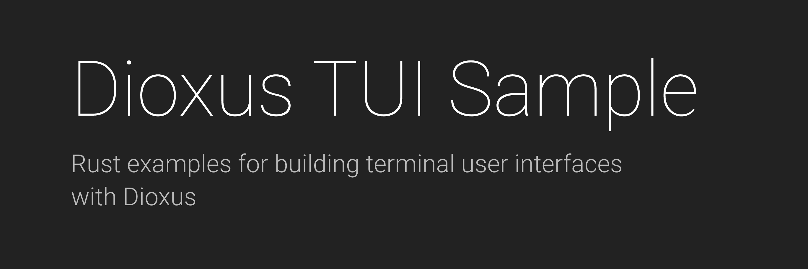
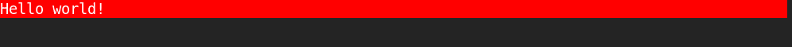
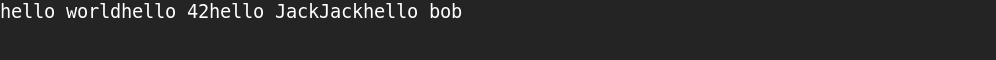
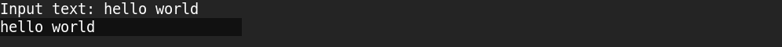
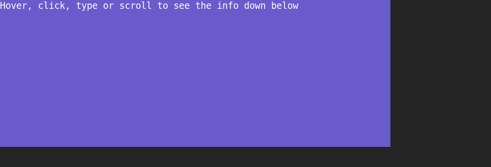

<p align="center"></p>

<p align="center"><strong>Rust examples for building terminal user interfaces with Dioxus</strong></p>

<p align="center"><a href="https://github.com/conao3/rust-dioxus-tui-sample/stargazers"></a></p>

<p align="center"><a href="#getting-started">Getting Started</a> | <a href="#examples">Examples</a> | <a href="#dependencies">Dependencies</a> | <a href="#license">License</a></p>

<h1>Dioxus TUI Sample</h1>

A collection of examples demonstrating [Dioxus](https://dioxuslabs.com/) for building terminal user interfaces in Rust.

## Overview

This project provides practical examples for learning Dioxus TUI, covering RSX syntax, component patterns, state management with hooks, and event handling in the terminal.

## Requirements

- Rust 1.98 or later
- Cargo

## Getting Started

Clone the repository and run the main application:

```bash
git clone https://github.com/conao3/rust-dioxus-tui-sample.git
cd rust-dioxus-tui-sample
cargo run
```



The screenshots in this README show the sample data built into the code, running in the foot terminal.

## Examples

### RSX Basics



**Simple RSX** - Basic RSX syntax with string interpolation and conditionals:

```bash
cargo run --example rsx-simple
```

**Components** - Creating reusable components with props:

```bash
cargo run --example rsx-components
```

**Iteration** - Rendering lists with iterators:

```bash
cargo run --example rsx-iter
```

### Hooks



**useSignal** - Managing component state:

```bash
cargo run --example hooks-usestate
```

**useFuture** - Handling async operations with automatic updates:

```bash
cargo run --example hooks-usefuture
```

### Terminal Events



**Event Handling** - Mouse, keyboard, wheel, and focus events:

```bash
cargo run --example tui-events
```

## Dependencies

| Crate | Version | Purpose |
|-------|---------|---------|
| dioxus | 0.7.10 | Core framework and HTML elements |
| dioxus-tui | 0.7.2 (pinned Git revision) | Terminal renderer |
| tokio | 1.x | Async runtime for the timer example |

## Resources

- [Dioxus 0.7 Documentation](https://dioxuslabs.com/learn/0.7/)
- [Dioxus GitHub](https://github.com/DioxusLabs/dioxus)

## License

MIT
